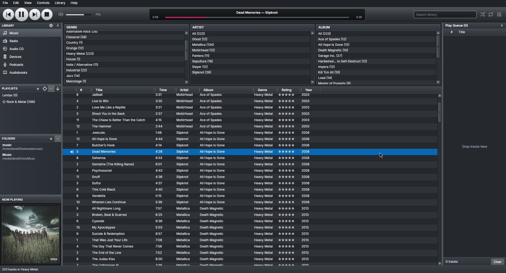

# Aibell

[](https://dotnet.microsoft.com/)
[](https://avaloniaui.net/)
[](#license-and-credits)

**Aibell** is a desktop music library and player for Linux and Windows, built with .NET 10 and
[Avalonia](https://avaloniaui.net/). It aims for a dense, practical library view, strong browsing and local-first
playback, in the spirit of Songbird and Banshee. On Linux, its default player uses managed decoders with PipeWire audio
output; ALSA, [miniaudio](https://miniaud.io/) and [LibVLC](https://www.videolan.org/vlc/libvlc.html) are also available.
Choose the playback engine under **Preferences → Playback**; the choice takes effect after restart.

Beyond ordinary music files, Aibell plays two kinds of game music with no extra software, in pure C#:
**MIDI** files (.mid, .midi, .rmi) through a built-in synthesizer or a SoundFont 2 bank you supply, and
**Super Nintendo music**: `.spc` files, and `.rsn` archives of them (RAR files holding a game's soundtrack, one track per SPC),
played by emulating the console's SPC700 processor and S-DSP sound chip. Audio CDs are read from the drive in C# as well.



## Features

**Library**

- Browse by genre, artist and album in a compact three-pane view; search with **Ctrl+F**.
- Watch one or more music folders; added, changed and removed files are reconciled automatically.
- Customise track columns: resize, reorder, hide, sort and best-fit.
- Ratings, play counts and preferences are stored in a local SQLite library.

**Playback**

- Seek, volume, mute, shuffle, repeat, pause and stop; a play queue that survives restarts and accepts dropped files.
- Playlists (create, rename, delete, sort, reorder, export to UTF-8 M3U8) and smart playlists with All/Any rules.
- Import M3U, M3U8 and PLS playlists after reviewing them.
- Internet radio: save HTTP/HTTPS direct-stream stations, import station playlists, reconnect explicitly.
- Formats include MP3, FLAC, Ogg Vorbis, Opus, WAV, AIFF (.aiff, .aif, .aifc), AAC-LC and Apple Lossless (M4A), MIDI, and SNES music (SPC and RSN).
  WMA is available through Windows Media Foundation or VLC. Support varies by engine and file encoding.
- SNES music: `.spc` files and the SPC tracks inside `.rsn` archives appear in the library like any other tracks (title, game as
  album, artist and length come from the file's own tags) and play with a fade-out at the tagged length. Seeking works; tag editing does not.
- Audio CD playback with an optional MusicBrainz lookup, read from the drive in C# by the built-in player (no VLC needed; Windows part written without a machine to test on).
- Podcasts: subscriptions, show notes and covers, a download queue, automatic progress and resume, 1x–2x speed and an
  hourly new-episode check you can switch off.
- Audiobooks: a shelf of local files with saved positions and chapter playback.

**Metadata and artwork**

- **View Metadata…** (context menu or **Alt+Enter**) shows detailed properties and edits tags in the library only, or
  writes them to the file (FLAC, M4A, MP3, Ogg, Opus and classic PCM WAV) with a verified backup you can restore.
- **Get Artwork…** looks up an album cover on MusicBrainz and saves it as `cover.jpg` in the album folder. It never
  replaces an existing cover file.
- Artwork from the file or the folder is shown in the now-playing panel.

**Devices and desktop**

- **Devices** copies music to a mounted USB drive, memory card or mass-storage player. It shows a preview first, only
  adds files (nothing on the device is ever deleted) and can write an `Aibell.m3u8` playlist.
- Linux: MPRIS media controls and optional track-change notifications. Windows: system media transport controls, notifications,
  taskbar progress and Previous/Play/Next thumbnail buttons.
- Plugins: **Preferences → Plugins** lists, enables, disables, installs and uninstalls plugins. Changes apply after a
  restart. A plugin runs inside the application with your permissions, so install only plugins you trust.
- Online lookups (MusicBrainz) come from a plugin and are **off by default**. Nothing is sent until you press Look up
  or Get Artwork and have allowed online lookup in **Preferences → Online**.
- Light, dark or system theme; keyboard-operable transport with accessible names.
- A main menu (File, Edit, View, Controls, Library, Help) with every action of the buttons and context menus; items
  enable and disable with the selected library item. **Help → About Aibell** shows the version, what this installation
  supports (player, VLC, media controls, plugins) and the acknowledgements.

**Languages:** English, Brazilian Portuguese, Spanish, Italian, French, German, Polish, Russian, Japanese, Simplified
Chinese, Hebrew and Arabic (right-to-left). The language follows the system; set `AIBELL_LANGUAGE` (for example
`AIBELL_LANGUAGE=de`) to override it.
On tiling compositors and bare window managers (niri, sway, Hyprland, i3, ...) the window has no title bar, since those
sessions draw none; set `AIBELL_TITLE_BAR=on` or `off` to override the detection. The translations have not been reviewed by native speakers.

## Install and run

There is no signed release yet. On Ubuntu and other Debian-based systems you can build an installable package
(see [Debian and Ubuntu package](#debian-and-ubuntu-package)); on Windows 11 x64, `./make.ps1 msi` builds an `.msi` installer.
Otherwise, build from source.

### Requirements

- [.NET 10 SDK](https://dotnet.microsoft.com/download/dotnet/10.0)
- A C compiler (`cc`, `gcc` or `clang` on Linux; the Visual Studio C++ build tools on Windows) to build the small
  native audio library that wraps miniaudio. The build does it automatically.
- The Linux PipeWire engine requires a running PipeWire service and `libpipewire-0.3.so.0`; the ALSA engine requires an
  ALSA device and `libasound`.
- Optional: a native **LibVLC 3** runtime for VLC playback and formats such as HE-AAC that the managed decoder does not support.

The PipeWire and ALSA engines use C# decoders and system audio libraries. On Linux the application prefers PipeWire,
then falls back to ALSA and miniaudio if the selected output is unavailable. If no built-in engine is available it
selects VLC. On Windows the default uses miniaudio; Windows Media Foundation supplies support for some formats.
The managed AAC implementation supports AAC-LC; HE-AAC, encrypted or fragmented MP4, Vorbis floor 0 and certain other
codec variants are unsupported. Select VLC for formats your chosen player cannot decode. Equalizer and pitch-preserving
speed controls are available in the built-in players.

To use VLC on Ubuntu and compatible distributions:

```bash
sudo apt install libvlc-dev vlc-plugin-base
```

On Windows, install a matching 64-bit VLC 3 or point `AIBELL_LIBVLC_PATH` at the folder that contains `libvlc.dll` and
`libvlccore.dll`.

### Build and run

```bash
git clone https://github.com/tiglate/Aibell.git
cd Aibell
./make.sh run
```

`make.sh` is the one wrapper for building, testing and publishing:

```bash
./make.sh build       # restore and compile the solution
./make.sh run         # build and start the desktop application
./make.sh test        # run the automated tests
./make.sh coverage    # Linux x64: full native tests and per-module coverage floors
./make.sh format      # apply C# formatting (add --verify-no-changes to only check)
./make.sh secrets     # scan tracked source for secrets (Linux x64)
./make.sh publish     # self-contained package for this host
./make.sh clean       # remove build and publish output
```

`CONFIGURATION=Release` selects a release build, and `RID=win-x64 ./make.sh publish` publishes for another runtime
identifier. Published files go to `artifacts/<runtime-id>/`. On Windows, use `./make.ps1` from PowerShell or
`./make.sh` from Git Bash.

### Where your data lives

|                                       | Location                                                           |
| ------------------------------------- | ------------------------------------------------------------------ |
| Library, settings, logs, user plugins | `~/.local/share/Aibell` (Linux), `%LOCALAPPDATA%\Aibell` (Windows) |
| Different profile                     | set `AIBELL_DATA_DIRECTORY` to an absolute folder                  |
| Album covers you save                 | `cover.jpg` inside the album folder                                |

Your music files are never moved, changed or deleted by the library, playlist, podcast or device features unless you explicitly
choose to write tags to a file.

### Environment variables

| Variable                | Purpose                                                                            |
| ----------------------- | ---------------------------------------------------------------------------------- |
| `AIBELL_DATA_DIRECTORY` | Absolute folder for the profile (library, settings, logs, user plugins)            |
| `AIBELL_LIBVLC_PATH`    | Absolute folder with the LibVLC runtime (Windows)                                  |
| `AIBELL_AUDIO_NULL`     | `1` makes the miniaudio player use a silent device (tests, machines without sound) |
| `AIBELL_LANGUAGE`       | UI language override, for example `pt-BR` or `ar`                                  |
| `AIBELL_TITLE_BAR`      | Set to `on` or `off` to override title-bar detection on Linux                      |

### Debian and Ubuntu package

```bash
./make.sh deb
sudo apt install ./artifacts/packages/aibell_*_amd64.deb
```

The package is self-contained (it carries the .NET runtime, ReadyToRun-compiled so it starts quickly) and targets
Ubuntu 24.04 and derivatives for x64. It installs to `/usr/lib/aibell`, adds the `aibell` command, a menu entry and icons, and
recommends LibVLC and an audio backend. Remove it with `sudo apt remove aibell`; your library in `~/.local/share` is left alone.

### AppImage, Flatpak and Snap

```bash
./make.sh appimage --download-runtime   # once: fetches the pinned AppImage runtime; needs squashfs-tools
./make.sh flatpak                       # needs flatpak-builder and the freedesktop 24.08 Platform and Sdk
./make.sh snap                          # builds the snap with snapcraft; needs LXD
```

The results are written to `artifacts/packages`. The AppImage, the Flatpak and the Snap have been started on Linux (the Snap plays local files and radio and has working media controls;
`removable-media` needs `sudo snap connect aibell:removable-media`).

## Keyboard shortcuts

| Keys                                                 | Action                                            |
| ---------------------------------------------------- | ------------------------------------------------- |
| **Ctrl+F** / **Escape**                              | Focus search / clear a focused query              |
| **Space**                                            | Play or pause from the track, queue or radio list |
| **Alt+Left** / **Alt+Right**                         | Previous / next track from the library            |
| **Alt+Enter**                                        | Track properties                                  |
| **Ctrl+,**                                           | Preferences                                       |
| **Ctrl+Q**                                           | Quit after pending work finishes                  |
| **Tab**, then arrows, **Page Up/Down**, **Home/End** | Adjust the focused seek or volume slider          |

## Project layout

The solution is `Aibell.slnx`; code is split into layers that only depend inward:

| Project                                             | Responsibility                                                                                                                                                   |
| --------------------------------------------------- | ---------------------------------------------------------------------------------------------------------------------------------------------------------------- |
| `Aibell.Domain`                                     | Framework-free media, playlist, podcast and playback rules                                                                                                       |
| `Aibell.Application`                                | Use cases and the ports the outer layers implement                                                                                                               |
| `Aibell.Infrastructure`                             | SQLite storage, settings, metadata, artwork, plugins, device sync                                                                                                |
| `Aibell.Audio.*`                                    | Managed decoders (AAC, WAV, FLAC, Ogg, Vorbis, Opus, MP3, ALAC, MIDI, SNES SPC), audio CD reader and shared audio code                                           |
| `Aibell.Archive.Rar`                                | Managed RAR 3/4/5 reader (decompress only) behind `.rsn` archives                                                                                                |
| `Aibell.Playback.Core`                              | Shared decoding pipeline, source selection, equalizer and speed control                                                                                          |
| `Aibell.Playback.PipeWire` / `Aibell.Playback.Alsa` | Linux output engines using managed decoders and system audio libraries                                                                                           |
| `Aibell.Playback.LibVLC`                            | LibVLC playback adapter                                                                                                                                          |
| `Aibell.Playback.Miniaudio`                         | Built-in playback engine over a small native shim (`native/aibell-audio`) around miniaudio                                                                       |
| `Aibell.Platform.Linux` / `Aibell.Platform.Windows` | Media session, notifications, optical drives and removable volumes                                                                                               |
| `Aibell.Metadata.MusicBrainz`                       | Optional online-lookup plugin, shipped in `plugins/` and loaded at run time                                                                                      |
| `Aibell.Desktop`                                    | The Avalonia UI and the composition root                                                                                                                         |
| `tools/AibellTools`                                 | Developer tool in C#: secret scan, coverage gate, candidate packaging, Linux publish smoke test (run with `dotnet run --project tools/AibellTools -- <command>`) |

Tests live in `tests/Aibell.*.Tests`. The user interface text is in `src/Aibell.Desktop/Resources/Strings*.resx`; to add a
language, copy `Strings.pt-BR.resx`, translate it, add the plural forms the language needs, list the culture in
`Aibell.Desktop.csproj` and in the `LocalizationTests`, and run the tests.

## Contributing

- Work on a branch and open a pull request; keep each change to one feature or fix, with tests.
- New code uses modern C# (file-scoped namespaces, nullable references, four-space indentation). Test methods are named
  `Action_ExpectedBehavior`. Keep the domain and application projects free of UI, database and operating-system
  dependencies, and prefer async APIs that take a `CancellationToken`.
- Run `./make.sh format`, `./make.sh test` and, on Linux, `./make.sh coverage` before pushing.
- NuGet package versions are pinned in `Directory.Packages.props` and locked per project; commit the regenerated
  `packages.lock.json` files with any dependency change.
- The project accepts no GPL-family or unverifiable dependencies. LibVLC (LGPL) is used as a dynamically loaded native
  library. miniaudio and stb_vorbis (vendored under `native/aibell-audio/vendor`) are public domain / MIT-0.

## License and credits

Aibell is released under the **MIT License**; the full text is in the `LICENSE` file. The one exception is `src/Aibell.Audio.Alac`, the Apple Lossless
decoder, which is a port of Apple's code and stays under the **Apache License 2.0** (`src/Aibell.Audio.Alac/LICENSE.Alac` and `NOTICE`).
`src/Aibell.Archive.Rar` is MIT too but derives from libarchive's BSD-licensed RAR readers; its notice is in `src/Aibell.Archive.Rar/COPYING.Rar`.
The managed Opus decoder includes material from RFC 6716; its notice is in `src/Aibell.Audio.Opus/COPYING.Opus`.

Copyright (c) 2026 Tiglate Pileser III.

Aibell is an independent project, written from scratch on .NET and Avalonia. It owes a debt to two earlier players:

- **Songbird**, the open-source media player. Much of Aibell's
  interface (the browsing panes, the source list, the dense track table) follows Songbird's design, which in turn drew
  on iTunes. Aibell copies no Songbird code or artwork; the resemblance is a deliberate homage.
- **Banshee**, the Mono/GTK media player, whose practical library view and local-first approach inspired Aibell.
  Aibell contains no Banshee source code.

Thank you to the people behind both projects. Aibell is not affiliated with or endorsed by them. Songbird and iTunes are trademarks of
their respective owners.

Third-party libraries keep their own licenses, including LibVLC and LibVLCSharp (LGPL), miniaudio and stb_vorbis (public
domain / MIT-0), Avalonia (MIT), Microsoft .NET libraries (MIT) and ATL .NET (MIT).
