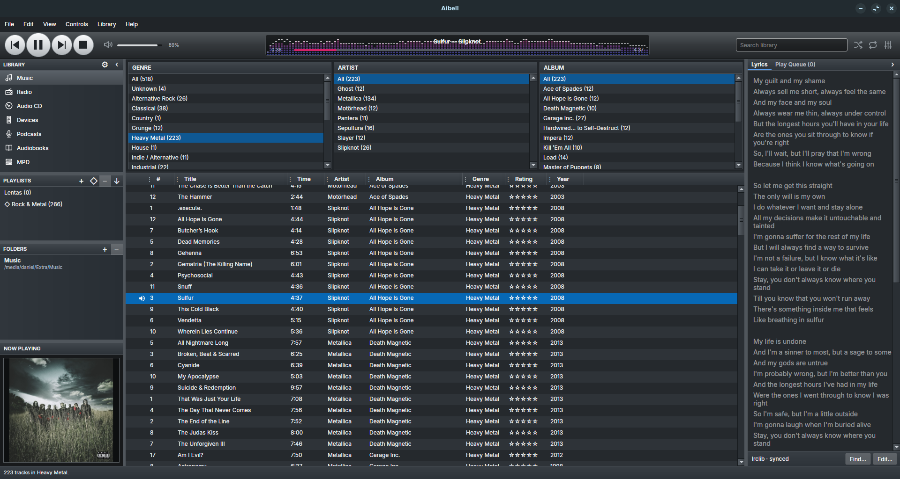
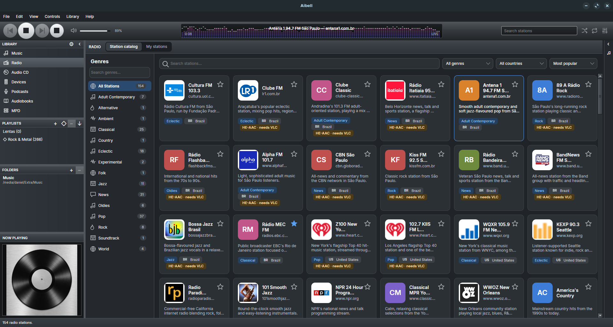
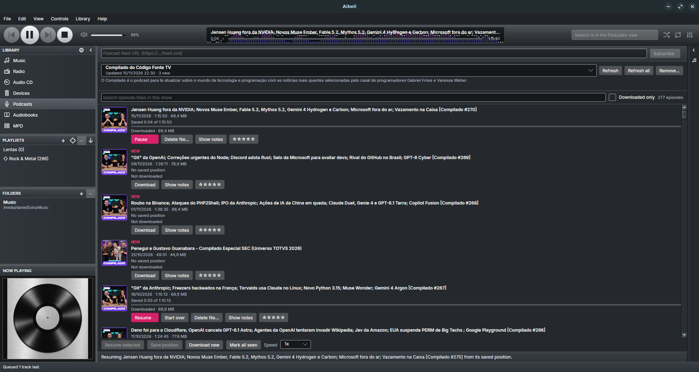
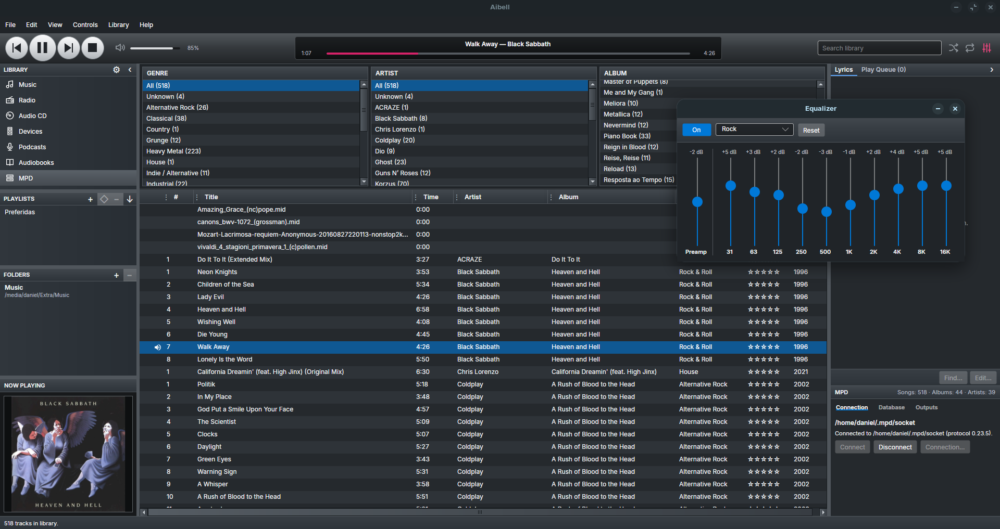

# Aibell

[](https://dotnet.microsoft.com/)
[](https://avaloniaui.net/)
[](#license-and-credits)

**Aibell** is a desktop music player and library for Linux and Windows. It gives you a dense, practical view of your
collection, fast browsing and search, and local-first playback, in the spirit of Songbird and Banshee, with extras
like synced lyrics, internet radio, podcasts, a live visualizer and a built-in equalizer.

Under the hood, Aibell ships its own audio decoders for the most common formats (MP3, FLAC, Ogg Vorbis, Opus, WAV, AIFF,
AAC and Apple Lossless), written in C#, so it plays your music without extra codecs or system libraries. You can choose
between several playback backends: the built-in player (PipeWire or ALSA on Linux, [miniaudio](https://miniaud.io/)
elsewhere) or [VLC](https://www.videolan.org/vlc/libvlc.html), under **Preferences → Playback**.



## A look around

| | |
| --- | --- |
|  |  |
| **Internet radio.** Browse a station catalog by genre and country, or save your own. | **Podcasts.** Subscribe, download, and pick up where you left off. |



## Features

**Your library**

- Browse by genre, artist and album in a compact three-pane view; search instantly with **Ctrl+F**.
- Point Aibell at your music folders; it notices added, changed and removed files on its own.
- Customize the track list: resize, reorder, hide and sort columns. Rate tracks; play counts are kept for you.
- Playlists and smart playlists (rules like "rating above 3 and genre is Rock"), with M3U, M3U8 and PLS import and export.
- Edit tags and cover art right from the app, with a backup you can restore. Album covers can be looked up online.

**Playback**

- A play queue that survives restarts and accepts dropped files; shuffle, repeat, seek, volume and mute.
- **Visualizer:** a live spectrum glows behind the progress bar, like the classic players. On by default; turn it off in
  **Preferences → General**.
- **Equalizer:** ten bands with presets, plus pitch-preserving speed control for podcasts. **Auto** gives each track the curve
  you last set while it played, or else the preset that suits its genre. A **balance** control pans between the left and right
  speakers (with the built-in player; VLC and MPD play centred).
- **Lyrics:** a tab beside the queue shows the lyrics of the playing track, highlighting the current line when they are
  time-synced. You can search, edit and save them into the file. (Lyrics lookups are on by default and can be switched
  off in **Preferences → Online**.)
- Formats: MP3, FLAC, Ogg Vorbis, Opus, WAV, AIFF, AAC and Apple Lossless (M4A), plus **MIDI** (with the built-in synthesizer or a
  SoundFont you provide) and **Super Nintendo music** (`.spc` files and `.rsn` archives). WMA and a few rarer
  encodings work through the VLC backend.
- **Audio CDs** play straight from the drive, with an optional online lookup for track names.

**Radio, podcasts and audiobooks**

- **Internet radio:** a built-in station catalog and your own saved stations.
- **Podcasts:** subscriptions, show notes, downloads, automatic resume and 1x–2x speed.
- **Audiobooks:** a shelf with saved positions and chapters.

**Works with MPD**

- Browse and play the library of a [Music Player Daemon](https://www.musicpd.org/) server, local or on your network, from the
  same interface, including its playlists, volume and outputs. Nothing connects until you press **Connect**.
- Edit the `mpd.conf` of an MPD running on your computer with a guided editor that keeps your comments and makes a backup on every save.

**Classic Player Mode**

- Prefer the look of the classic players? **View → Classic Player Mode** (**Ctrl+Shift+M**) turns Aibell into a compact,
  skinnable player in the style of Winamp 2: main window, equalizer and playlist as separate windows that snap together, each of
  which you can hide or roll up into a thin bar, at normal or double size. Dragging the main window carries the windows docked
  to it; dragging another one pulls it away. Aibell remembers where you left them. **Separate windows** in the options menu
  switches to a single window with the three stacked instead (useful where a desktop does not let applications place their
  windows). **Standard mode** in its options menu (the top-left button, or
  right-click anywhere) brings the full window back. Music keeps playing while you switch, and Aibell reopens in the mode you
  left it in.
- It plays local music only (no radio, podcasts or MPD). Its playlist is its own: it keeps its tracks after they play and is
  saved between sessions. Add music with the playlist's **Add** button (files, a folder, or your Aibell library, which **J**
  also searches), by dropping files on the window, or by loading one of your Aibell playlists or an M3U/PLS file.
- It draws **classic Winamp skins** (`.wsz` or `.zip`). Aibell comes with a skin of its own; install others from a file, or
  browse and install skins from the [Winamp Skin Museum](https://skins.webamp.org/) right inside Aibell (**Skins → Manage
  skins…**). The online browser only appears when online lookups are switched on in **Preferences → Online**, and skins the
  museum flags as not safe for work are never shown. Modern (`.wal`) skins and Winamp plug-ins are not supported.
- The classic keys work: **Z X C V B** for previous, play, pause, stop and next, **L** to play files, **S** and **R** for shuffle
  and repeat, **Ctrl+D** for double size, **Ctrl+T** for remaining time, **Alt+G** / **Alt+E** for the equalizer and
  playlist, and arrows to seek and pick tracks.

**Desktop**

- Copy music to a USB drive, memory card or portable player, with a preview first. Nothing on the device is ever deleted.
- Media keys and desktop notifications (MPRIS on Linux; system media controls and taskbar buttons on Windows).
- Light, dark or system theme, full keyboard control, and a plugin system for online lookups and lyrics.
- Available in English, Brazilian Portuguese, Spanish, Italian, French, German, Polish, Russian, Japanese, Simplified
  Chinese, Hebrew and Arabic. The language follows your system; set `AIBELL_LANGUAGE` (for example `AIBELL_LANGUAGE=de`)
  to override it. The translations have not been reviewed by native speakers.
- On tiling window managers (niri, sway, Hyprland, i3, ...) the window has no title bar; set `AIBELL_TITLE_BAR=on` or `off`
  to override the detection.

**Privacy:** online lookups (covers, track names) are **off by default** and only run when you ask. Lyrics lookups are on by
default and send a track's title, artist, album and length to lrclib.net; switch them off in Preferences. Your music files are
never changed unless you explicitly choose to write tags.

## Install and run

There is no signed release yet. On Ubuntu and other Debian-based systems you can build an installable package
(see [Debian and Ubuntu package](#debian-and-ubuntu-package)); on Windows 11 x64, `./make.ps1 msi` builds an `.msi` installer.
Otherwise, build from source.

### Requirements

- [.NET 10 SDK](https://dotnet.microsoft.com/download/dotnet/10.0)
- A C compiler (`cc`, `gcc` or `clang` on Linux; the Visual Studio C++ build tools on Windows) to build the small
  native audio library that wraps miniaudio. The build does it automatically.
- The Linux PipeWire engine requires a running PipeWire service and `libpipewire-0.3.so.0`; the ALSA engine requires an
  ALSA device and `libasound`.
- Optional: a native **LibVLC 3** runtime for VLC playback and formats such as HE-AAC that the managed decoder does not support.

On Linux the built-in player prefers PipeWire, then falls back to ALSA and miniaudio, and finally to VLC if none is
available. On Windows the default uses miniaudio. The C# decoders do not cover HE-AAC, encrypted or fragmented MP4 and a few
rare codec variants; select VLC for those. The equalizer and pitch-preserving speed control work in the built-in players.

To use VLC on Ubuntu and compatible distributions:

```bash
sudo apt install libvlc-dev vlc-plugin-base
```

On Windows, install a matching 64-bit VLC 3 or point `AIBELL_LIBVLC_PATH` at the folder that contains `libvlc.dll` and
`libvlccore.dll`.

### Build and run

```bash
git clone https://github.com/tiglate/Aibell.git
cd Aibell
./make.sh run
```

`make.sh` is the one wrapper for building, testing and publishing:

```bash
./make.sh build       # restore and compile the solution
./make.sh run         # build and start the desktop application
./make.sh test        # run the automated tests
./make.sh coverage    # Linux x64: full native tests and per-module coverage floors
./make.sh format      # apply C# formatting (add --verify-no-changes to only check)
./make.sh secrets     # scan tracked source for secrets (Linux x64)
./make.sh publish     # self-contained package for this host
./make.sh clean       # remove build and publish output
```

`CONFIGURATION=Release` selects a release build, and `RID=win-x64 ./make.sh publish` publishes for another runtime
identifier. Published files go to `artifacts/<runtime-id>/`. On Windows, use `./make.ps1` from PowerShell or
`./make.sh` from Git Bash.

### Where your data lives

|                                       | Location                                                           |
| ------------------------------------- | ------------------------------------------------------------------ |
| Library, settings, logs, user plugins, MPD host and port | `~/.local/share/Aibell` (Linux), `%LOCALAPPDATA%\Aibell` (Windows) |
| Different profile                     | set `AIBELL_DATA_DIRECTORY` to an absolute folder                  |
| Album covers you save                 | `cover.jpg` inside the album folder                                |

Your music files are never moved, changed or deleted by the library, playlist, podcast or device features unless you explicitly
choose to write tags to a file.

### Environment variables

| Variable                | Purpose                                                                            |
| ----------------------- | ---------------------------------------------------------------------------------- |
| `AIBELL_DATA_DIRECTORY` | Absolute folder for the profile (library, settings, logs, user plugins)            |
| `AIBELL_LIBVLC_PATH`    | Absolute folder with the LibVLC runtime (Windows)                                  |
| `AIBELL_AUDIO_NULL`     | `1` makes the miniaudio player use a silent device (tests, machines without sound) |
| `AIBELL_LANGUAGE`       | UI language override, for example `pt-BR` or `ar`                                  |
| `AIBELL_TITLE_BAR`      | Set to `on` or `off` to override title-bar detection on Linux                      |

### Debian and Ubuntu package

```bash
./make.sh deb
sudo apt install ./artifacts/packages/aibell_*_amd64.deb
```

The package is self-contained (it carries the .NET runtime, ReadyToRun-compiled so it starts quickly) and targets
Ubuntu 24.04 and derivatives for x64. It installs to `/usr/lib/aibell`, adds the `aibell` command, a menu entry and icons, and
recommends LibVLC and an audio backend. Remove it with `sudo apt remove aibell`; your library in `~/.local/share` is left alone.

### AppImage, Flatpak and Snap

```bash
./make.sh appimage --download-runtime   # once: fetches the pinned AppImage runtime; needs squashfs-tools
./make.sh flatpak                       # needs flatpak-builder and the freedesktop 24.08 Platform and Sdk
./make.sh snap                          # builds the snap with snapcraft; needs LXD
```

The results are written to `artifacts/packages`. The AppImage, the Flatpak and the Snap have been started on Linux (the Snap plays local files and radio and has working media controls;
`removable-media` needs `sudo snap connect aibell:removable-media`).

## Keyboard shortcuts

| Keys                                                 | Action                                            |
| ---------------------------------------------------- | ------------------------------------------------- |
| **Ctrl+F** / **Escape**                              | Focus search / clear a focused query              |
| **Space**                                            | Play or pause from the track, queue or radio list |
| **Alt+Left** / **Alt+Right**                         | Previous / next track from the library            |
| **Alt+Enter**                                        | Track properties                                  |
| **Ctrl+,**                                           | Preferences                                       |
| **Ctrl+Q**                                           | Quit after pending work finishes                  |
| **Ctrl+Shift+M**                                     | Switch to Classic Player Mode and back            |
| **Tab**, then arrows, **Page Up/Down**, **Home/End** | Adjust the focused seek or volume slider          |

## For developers

The solution is `Aibell.slnx`, split into layers that only depend inward: `Aibell.Domain` and `Aibell.Application` (rules and
ports), `Aibell.Infrastructure` (storage, metadata, plugins), `Aibell.Audio.*` (the managed decoders), `Aibell.Playback.*`
(the PipeWire, ALSA, miniaudio and LibVLC backends), `Aibell.Mpd`, `Aibell.Platform.*` and `Aibell.Desktop` (the Avalonia UI).
Tests live in `tests/Aibell.*.Tests`. The interface text is in `src/Aibell.Desktop/Resources/Strings*.resx`; to add a
language, copy `Strings.pt-BR.resx`, translate it, add the plural forms the language needs, list the culture in
`Aibell.Desktop.csproj` and in the `LocalizationTests`, and run the tests.

## Contributing

- Work on a branch and open a pull request; keep each change to one feature or fix, with tests.
- New code uses modern C# (file-scoped namespaces, nullable references, four-space indentation). Test methods are named
  `Action_ExpectedBehavior`. Keep the domain and application projects free of UI, database and operating-system
  dependencies, and prefer async APIs that take a `CancellationToken`.
- Run `./make.sh format`, `./make.sh test` and, on Linux, `./make.sh coverage` before pushing.
- NuGet package versions are pinned in `Directory.Packages.props` and locked per project; commit the regenerated
  `packages.lock.json` files with any dependency change.
- The project accepts no GPL-family or unverifiable dependencies. LibVLC (LGPL) is used as a dynamically loaded native
  library. miniaudio and stb_vorbis (vendored under `native/aibell-audio/vendor`) are public domain / MIT-0.

## License and credits

Aibell is released under the **MIT License**; the full text is in the `LICENSE` file. The one exception is `src/Aibell.Audio.Alac`, the Apple Lossless
decoder, which is a port of Apple's code and stays under the **Apache License 2.0** (`src/Aibell.Audio.Alac/LICENSE.Alac` and `NOTICE`).
`src/Aibell.Archive.Rar` is MIT too but derives from libarchive's BSD-licensed RAR readers; its notice is in `src/Aibell.Archive.Rar/COPYING.Rar`.
The managed Opus decoder includes material from RFC 6716; its notice is in `src/Aibell.Audio.Opus/COPYING.Opus`.

Copyright (c) 2026 Tiglate Pileser III.

Aibell is an independent project, written from scratch on .NET and Avalonia. It owes a debt to two earlier players:

- **Songbird**, the open-source media player. Much of Aibell's
  interface (the browsing panes, the source list, the dense track table) follows Songbird's design, which in turn drew
  on iTunes. Aibell copies no Songbird code or artwork; the resemblance is a deliberate homage.
- **Banshee**, the Mono/GTK media player, whose practical library view and local-first approach inspired Aibell.
  Aibell contains no Banshee source code.

Thank you to the people behind both projects. Aibell is not affiliated with or endorsed by them. Songbird and iTunes are trademarks of
their respective owners.

Classic Player Mode is a homage to **Winamp** and reads the classic skin format Winamp 2 introduced. Its skin handling follows the
format as documented by [Webamp](https://github.com/captbaritone/webamp) (MIT License, Copyright (c) 2015 Jordan Eldredge), the
web re-creation of Winamp whose museum at skins.webamp.org the skin browser uses. Aibell ships no Winamp code or artwork: its own
skin, pixel font and digits are drawn from scratch. Aibell is not affiliated with or endorsed by Winamp, Webamp or the Winamp Skin
Museum; Winamp is a trademark of its owner, and each skin belongs to its author.

Third-party libraries keep their own licenses, including LibVLC and LibVLCSharp (LGPL), miniaudio and stb_vorbis (public
domain / MIT-0), Avalonia (MIT), Microsoft .NET libraries (MIT) and ATL .NET (MIT).
